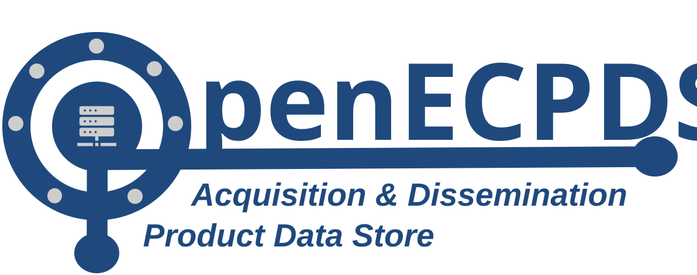

> **Our mission with OpenECPDS is to keep data moving.**  
> Acquire from anywhere. Deliver everywhere. Connect with confidence. Share without limits.

OpenECPDS is an open-source data management platform developed at
[ECMWF](https://www.ecmwf.int/). Built for demanding meteorological operations, it
works with files from any domain: automate provider ingestion, distribute data to
partners, and offer self-service access across on-premises and cloud environments.

| Service | What it does |
|---|---|
| **Data Acquisition** | Discovers and retrieves data from remote providers |
| **Data Dissemination** | Distributes data products to remote sites |
| **Data Portal** | Provides client-initiated upload and download access |

OpenECPDS scales from a laptop to large deployments and supports protocols including
FTP, SFTP, HTTPS, WebDAV, S3, cloud object storage and MQTT.

[Watch the introduction](https://www.youtube.com/watch?v=GQj0Q0Nd9to) ·
[Why OpenECPDS?](https://ecmwf.github.io/open-ecpds/why-openecpds/) ·
[Documentation](https://ecmwf.github.io/open-ecpds/)

### OpenECPDS in ten minutes

A narrated introduction to the standalone environment, transfer controls, MQTT
notifications, S3 access and the Monitor UI.

https://github.com/user-attachments/assets/951b8fcf-59a8-4de8-b876-d73c2c99aec6

---

## 🚀 Try it now — no build required

The standalone image bundles the Master, Data Mover, Monitor, MariaDB and OpenBao
in one container. It is intended for **evaluation, demos and local exploration**,
not production.

**Requirements:** Docker 20.10+, 4 GB RAM recommended, 4.5 GB for the image and
10 GB or more recommended for data. See the
[standalone guide](https://ecmwf.github.io/open-ecpds/getting-started/standalone/)
for minimum requirements and deployment details.

```bash
docker run -d \
  --name standalone \
  --stop-timeout 180 \
  -v "$(pwd)/ecpds-data:/data" \
  -p 7443:7443 \
  -p 7022:7022 \
  -p 8443:8443 \
  -p 8883:8883 \
  -p 127.0.0.1:9640:9640 \
  -p 127.0.0.1:7640:7640 \
  -p 127.0.0.1:8080:8080 \
  -p 127.0.0.1:9404:9404 \
  -p 127.0.0.1:9405:9405 \
  -p 127.0.0.1:9406:9406 \
  ghcr.io/ecmwf/open-ecpds/standalone:latest
```

Start with an **empty** `./ecpds-data` directory and allow about 30 seconds for
startup. The database and embedded vault initialize automatically. Preserve
`./ecpds-data` and the matching image build: the volume is tied to that build. See
[backup and recovery](https://ecmwf.github.io/open-ecpds/getting-started/standalone/#backup-and-recovery).

Retrieve the generated initial credentials as the container administrator:

```bash
docker exec standalone cat /data/lib/standalone/initial-accounts
```

This root-only file contains sensitive credentials: record them securely and
remove it afterwards. It does not reflect later password changes. The REST API
secret is stored separately; see
[access instructions](https://ecmwf.github.io/open-ecpds/getting-started/standalone/#access).

Open **[the Monitor](https://localhost:8443)** and sign in as `admin` using its
generated password. The **[Data Portal](https://localhost:7443)** uses the `test`
account; S3 has a separate generated secret. In the Monitor, open **Transmission
→ Destinations**, select `hourly_aq` and click **Start Destination** to acquire
sample data. This requires outbound Internet access.

> The initial TLS certificates are self-signed, so your browser will show a
> warning. For connections beyond a trusted test environment, configure clients
> to verify a trusted certificate and hostname. See
> [HTTPS certificate guidance](https://ecmwf.github.io/open-ecpds/getting-started/standalone-security/#trusting-or-replacing-the-https-certificate)
> and [SFTP host-key verification](https://ecmwf.github.io/open-ecpds/getting-started/sftp-host-keys/).

The command publishes the portal, SFTP, Monitor and MQTT ports on all host
interfaces. Restrict their exposure as appropriate. CLI, Hawtio and unauthenticated
metrics ports are bound to localhost; keep them off untrusted networks. CLI
connections are unencrypted: use an encrypted tunnel for remote access. See the
[CLI guide](https://ecmwf.github.io/open-ecpds/getting-started/ecpds-cli/#using-the-cli-against-the-standalone-container).

### Try the protocols

Use the generated `test` password from `initial-accounts` when prompted. These
examples assume the container is running locally. The `-k` and
`--no-verify-ssl` options bypass certificate verification **only for a trusted
local evaluation**; use verified TLS for other connections.

**HTTPS and WebDAV** — list destinations or browse the portal at
[`https://localhost:7443`](https://localhost:7443):

```bash
curl -k -u test -H "Accept: application/json" \
  https://localhost:7443/ecpds/data/list/
curl -k -u test -X PROPFIND https://localhost:7443/webdav/
```

**SFTP** — [verify the SSH host key](https://ecmwf.github.io/open-ecpds/getting-started/sftp-host-keys/),
then connect and list the sample destination:

```bash
sftp -P 7022 test@localhost
```

At the SFTP prompt, enter `ls /hourly_aq` and `bye`. Files appear after the
destination has acquired data.

**S3** — with the [AWS CLI](https://docs.aws.amazon.com/cli/latest/userguide/getting-started-install.html),
configure a separate profile with access key `test` and the generated `test_s3`
secret, then list the portal:

```bash
aws configure --profile openecpds-demo
aws --profile openecpds-demo s3 ls s3:// \
  --endpoint-url https://localhost:7443/s3 --no-verify-ssl
```

AWS CLI stores the profile credentials locally; protect that file and remove
the profile when no longer needed.

### Try MQTT upload notifications

The `mqtt_demo` destination demonstrates notifications without an external
provider. **Leave it stopped** in the Monitor: uploads remain available in
HOLD and trigger notification publication.

In one terminal, subscribe with [mqttx CLI](https://mqttx.app/cli). Enter the
generated `test` password when prompted:

```bash
read -rs -p 'Test password: ' TEST_PASSWORD; echo
mqttx sub -h localhost -p 8883 -l mqtts \
  -u test -P "$TEST_PASSWORD" --insecure -t 'openecpds/demo/#'
```

Wait for the subscription to connect and leave it running. The password may
still be visible in the process arguments; use this only on a trusted host.
`--insecure` is for the self-signed certificate in this local evaluation.

In another terminal, create and upload a file:

```bash
printf 'Hello from the standalone MQTT demo!\n' > mqtt-demo.txt
sftp -P 7022 test@localhost
```

After entering the password and verifying the host key, run at the SFTP prompt:

```text
put mqtt-demo.txt /mqtt_demo/mqtt-demo.txt
bye
```

Allow roughly a minute for asynchronous publication. The subscriber receives a
JSON notification with download links. Check the file over HTTPS:

```bash
curl --fail -k -u test \
  https://localhost:7443/ecpds/data/file/mqtt_demo/mqtt-demo.txt
```

In the Monitor, **Operations → MQTT Activity** shows publication outcomes.
See the [full MQTT walkthrough](https://ecmwf.github.io/open-ecpds/getting-started/standalone/#try-mqtt-upload-notifications)
for troubleshooting and remote access.

Explore more in the **[standalone guide](https://ecmwf.github.io/open-ecpds/getting-started/standalone/)**:
REST API and Aviso examples, logs, backup and recovery. To submit files from
the command line, see the [ECPDS CLI guide](https://ecmwf.github.io/open-ecpds/getting-started/ecpds-cli/#using-the-cli-against-the-standalone-container).

---

## 📖 Documentation

Browse the [documentation guide](https://ecmwf.github.io/open-ecpds/documentation-guide/)
or jump to a common task:

| I want to… | Start here |
|---|---|
| Try OpenECPDS or understand how it works | [Standalone container](https://ecmwf.github.io/open-ecpds/getting-started/standalone/) · [Architecture overview](https://ecmwf.github.io/open-ecpds/architecture/overview/) |
| Install and configure a deployment | [Installation](https://ecmwf.github.io/open-ecpds/getting-started/installation/) · [Kubernetes](https://ecmwf.github.io/open-ecpds/deployment/kubernetes/) · [Service configuration](https://ecmwf.github.io/open-ecpds/configuration/master/) |
| Set up data exchange | [Acquisition](https://ecmwf.github.io/open-ecpds/use-cases/acquisition/) · [Dissemination](https://ecmwf.github.io/open-ecpds/use-cases/dissemination/) · [Data Portal](https://ecmwf.github.io/open-ecpds/use-cases/data-portal/) · [Transfer modules](https://ecmwf.github.io/open-ecpds/transfer-modules/) |
| Notify consumers or replicate a destination | [MQTT](https://ecmwf.github.io/open-ecpds/notifications/mqtt-overview/) · [Notification history and Aviso](https://ecmwf.github.io/open-ecpds/notifications/history/) · [Aviso replication](https://ecmwf.github.io/open-ecpds/notifications/aviso-acquisition/) |
| Operate or troubleshoot the service | [Monitor UI](https://ecmwf.github.io/open-ecpds/monitor-ui/overview/) · [TLS certificates](https://ecmwf.github.io/open-ecpds/administration/certificates/) · [Monitoring](https://ecmwf.github.io/open-ecpds/monitoring/jmx-export/) · [Event logging](https://ecmwf.github.io/open-ecpds/event-logging/overview/) |
| Automate, integrate or contribute | [CLI](https://ecmwf.github.io/open-ecpds/getting-started/ecpds-cli/) · [REST API](https://ecmwf.github.io/open-ecpds/rest-api/) · [Java API](https://ecmwf.github.io/open-ecpds/api-reference/) · [Contributing](https://ecmwf.github.io/open-ecpds/contributing/) |

[Changelog](https://ecmwf.github.io/open-ecpds/changelog/) ·
[Glossary](https://ecmwf.github.io/open-ecpds/glossary/) ·
[Support](https://ecmwf.github.io/open-ecpds/support/)

---

## 🛠 Build from source

From the repository root, with Docker available:

```bash
make dev
```

Inside the development container:

```bash
make build
cd run/bin/ecpds && make up
```

The Monitor is available at `https://localhost:3443` and the Data Portal at
`https://localhost:4443`. To build the standalone image instead, run `make build-sa`
inside the development container. Use `make help` to list available targets.

See the [installation guide](https://ecmwf.github.io/open-ecpds/getting-started/installation/)
for the complete development workflow, including `make dev-pull` and its
requirements. For optional local services, see
[OpenBao setup](https://ecmwf.github.io/open-ecpds/deployment/kubernetes/#openbao-credential-vault)
and [OpenTelemetry testing](https://ecmwf.github.io/open-ecpds/getting-started/ide-setup/#local-opentelemetry-and-journal-testing).

---

## 📜 License

Copyright 2022–2026 ECMWF. Licensed under the [Apache License 2.0](LICENSE.txt).
