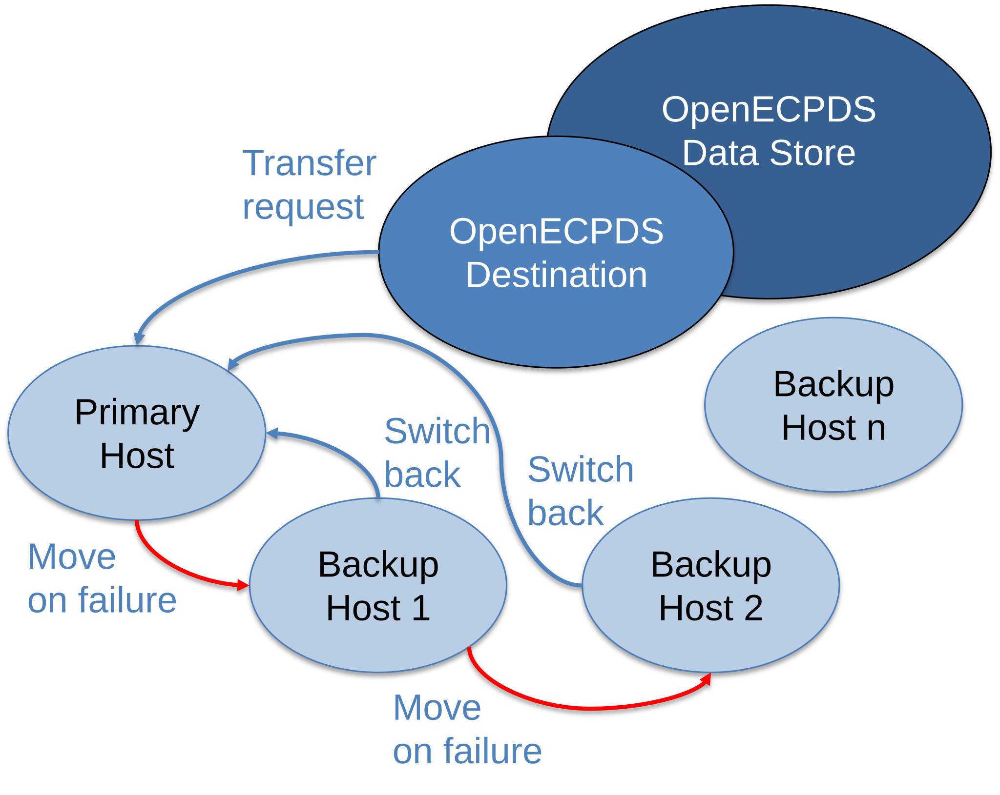

# Failover Mechanism in Host Selection

OpenECPDS manages failures by dynamically switching between available hosts. It
sequentially attempts to connect to each host in the list, moving to the next one if a
failure occurs.

A [destination](../concepts/entities.md#destinations-and-aliases) can be associated with
a list of [dissemination hosts](../concepts/entities.md#dissemination-and-acquisition-hosts),
with a **primary host** indicating the main target system where to deliver the data, and
a list of **fall-back hosts** to switch to if for some reason the primary host is
unavailable.

## Behaviour

The behaviour of the failover mechanism depends on the configuration of the transfer
scheduler:

- It can either **continue using the first successfully connected host** or **revert to
  the primary host** once it becomes available.
- The switch can occur **immediately after a successful transfer** or **after a
  predefined time interval**.

## How it works

1. OpenECPDS attempts to connect to the primary host.
2. If the connection fails, it moves to the next host in the configured list.
3. It continues down the list until a host connects successfully.
4. Depending on configuration, it either stays on the connected host or reverts to the
   primary host when it becomes available again — immediately or after a time interval.

This mechanism ensures continuity of service even when individual target systems become
temporarily unavailable.

{ width="400" }

## Destination retry controls

The Destination edit page provides a **Limits & Failover Guide** from
the Delivery and Limits cards. Host retry settings and Destination retry settings
operate at different levels:

| Setting | Scope and effect |
|---|---|
| Host Retry Count / Retry Frequency | Retry budget and wait for the selected dissemination Host before moving to the next Host. |
| Destination Retry Count / Retry Frequency | Repeated unsuccessful cycles through the Host list. The frequency delays another cycle; reaching the configured retry threshold holds the Destination and requires operator intervention. |
| Max Start / Start Frequency | Per-transfer start threshold. Reaching a positive threshold resets the start counter and increments the requeue counter; unless Max Requeue is reached, the transfer waits for Start Frequency. |
| Max Requeue | A positive threshold on those per-transfer requeue cycles. Reaching it marks the transfer failed rather than holding the entire Destination. |
| Reset Frequency | Can restart the Destination after sustained use of a backup Host. |

Host selection affects new dispatches; transfers already running on a previous
Host can still finish there. Acquisition Hosts are processed independently, not
as this dissemination failover chain.

Concurrency is separate from retries: the Destination maximum caps scheduled
retrievals and outgoing transfers as **two independent pools**, with Host limits
also applying. See [File-transfer connection limits](../host-directory/index.md#file-transfer-connection-limits).
Increasing concurrency does not clear a held Destination or repair a failing Host.

## Related

- [Components](components.md)
- [Lifecycle of a Data Transfer](data-transfer-lifecycle.md)
- [OpenECPDS Entities](../concepts/entities.md)
