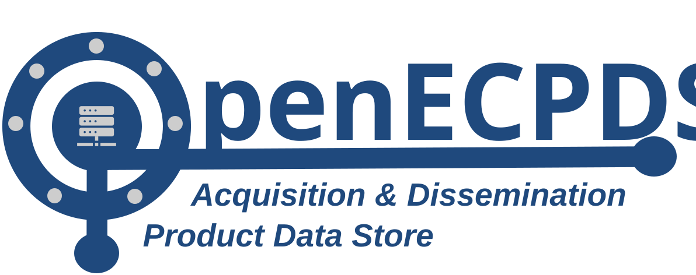
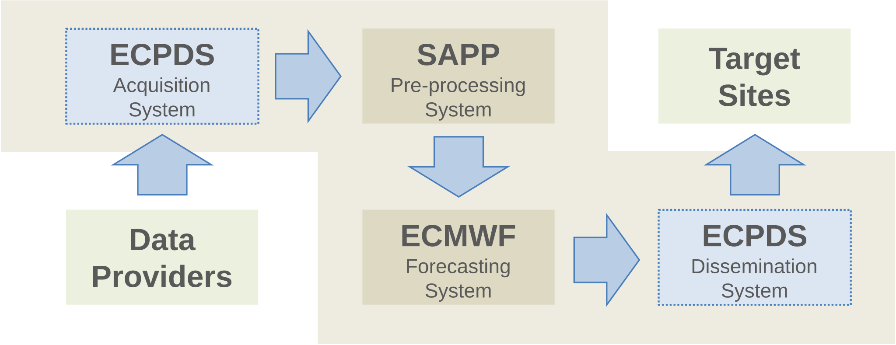

# OpenECPDS Documentation

{ width="420" .no-box }

> **Our mission with OpenECPDS is to keep data moving.**
>
> Inspired by operational excellence. Powered by open-source innovation. Acquire from
> anywhere. Deliver everywhere. Connect with confidence. Share without limits.

OpenECPDS is a multi-purpose data repository — the **Data Store** — that delivers three
strategic data-related services:

- **Data Acquisition** — the automatic discovery and retrieval of data from data providers.
- **Data Dissemination** — the automatic distribution of data products to remote sites.
- **Data Portal** — the pulling and pushing of data initiated by remote sites.

Data Acquisition and Data Dissemination are active services initiated by OpenECPDS,
whereas the Data Portal is a passive service triggered by incoming requests from remote
sites. The Data Portal provides interactive access to the Dissemination and Acquisition
services.

OpenECPDS enhances data services by integrating innovative technologies to streamline
the acquisition, dissemination, and storage of data across diverse environments and
protocols.

**OpenECPDS is domain-agnostic, not specific to meteorology.** Its origins at ECMWF
reflect demanding operational requirements, not restrictions on the data it can
handle. The core moves and stores files without requiring a particular scientific
format or subject matter. Research, industry, public services and enterprise teams
can use the same acquisition, dissemination and portal services to exchange their
own datasets, automate partner delivery and bridge on-premises and cloud storage.
Domain-specific integrations, such as WMO WIS2, are optional.

## OpenECPDS in ten minutes

Watch a narrated introduction to the standalone environment, transfer controls,
custom MQTT notifications, S3 access and the Monitor UI.

<video controls playsinline preload="metadata" width="100%" aria-label="OpenECPDS: a ten-minute narrated introduction">
  <source src="https://github.com/user-attachments/assets/951b8fcf-59a8-4de8-b876-d73c2c99aec6" type="video/mp4">
  Your browser does not support embedded video.
</video>

[Watch or download the video](https://github.com/user-attachments/assets/951b8fcf-59a8-4de8-b876-d73c2c99aec6).

## Why OpenECPDS

- :material-cloud-sync: **Acquire from anywhere**

    Automatically discover and retrieve data from providers over FTP, SFTP, FTPS,
    HTTP/S, WebDAV, Amazon S3, Azure and Google Cloud Storage.

- :material-share-variant: **Deliver everywhere**

    Disseminate products to more than 1,000 destinations across 80+ countries with a
    fully customisable, retry-aware transfer scheduler.

- :material-web: **Data Portal for all users**

    A built-in portal lets anonymous, self-registered, or authorised users push and
    pull data over FTP, SFTP, SCP, HTTPS, WebDAV and S3 — no custom integration needed.
    One platform handles both incoming and outgoing traffic.

- :material-bell-ring: **Real-time notifications**

    An embedded MQTT broker and client enable instant notifications and integration
    with the WMO WIS2 infrastructure.

- :material-docker: **Container-native**

    The [standalone image](getting-started/standalone.md) runs the full stack on a
    laptop for instant evaluation. For production, each component (Master, Data Mover,
    Monitor) has its own container and can be deployed independently or orchestrated at
    scale with [Kubernetes](deployment/kubernetes.md).

- :material-source-branch: **Open and extensible**

    New outgoing protocols plug into the [transfer module framework](transfer-modules/index.md);
    new incoming protocols plug into the [server plugin framework](concepts/plugin-infrastructure.md)
    (`SshPlugin`, `HttpPlugin`, `FtpPlugin`…). Open-source and actively developed by ECMWF.

[Why OpenECPDS? →](why-openecpds.md){ .md-button }

## Quick links

- **New here?** Try the [Standalone container](getting-started/standalone.md) — no build needed, up and running in minutes.
- **Full setup:** [System Requirements](getting-started/requirements.md) → [Installation](getting-started/installation.md) → [First Run](getting-started/first-run.md).
- **Understand the system:** [Architecture Overview](architecture/overview.md) and
  [Key Concepts](concepts/entities.md).
- **Centralised or federated?** See [Centralised vs. Federated](architecture/federation-vs-centralization.md)
  and [Data Ownership & Catalogue](architecture/data-ownership-and-catalogue.md) for how OpenECPDS
  fits into different organisational and operating models.
- **Configure transfers:** [Transfer Modules](transfer-modules/index.md) and the
  [Host Directory Field](host-directory/index.md).
- **Operate & monitor:** [Event Logging](event-logging/overview.md) and the
  [MQTT Notification System](notifications/mqtt-overview.md).

## Architecture at a glance

{ width="450" }

| Component | Role |
|-----------|------|
| [Master Server](architecture/components.md#master-server) | Central coordinator — authentication, metadata, scheduling, Data Mover allocation. |
| [Mover Server (Data Mover)](architecture/components.md#mover-server-data-mover) | Moves bytes — connects to remote systems via transfer modules, stores/streams content. |
| [Monitor Server](architecture/components.md#monitor-server) | Web monitoring interface for destinations, transfers and hosts. |
| [Data Portal](architecture/components.md#data-portal) | Incoming FTP/SFTP/SCP/HTTPS/WebDAV/S3 access for remote sites to push and pull data. |
| Database | Persists metadata, destinations, hosts, transfers and history. |

See the [Architecture Overview](architecture/overview.md) for how these components work
together, and [Continental Data Movers](architecture/continental-data-movers.md) for
geographically distributed dissemination.

## Core capabilities

### Data exchange

- **Multiple protocols** — FTP, SFTP, FTPS, SCP, HTTP/S, WebDAV, Amazon S3, Azure Blob and Google
  Cloud Storage. See [Protocols & Connections](concepts/protocols.md).
- **Data Portal — incoming and outgoing in one platform** — remote users can push
  data in *and* pull data out over FTP, SFTP, SCP, HTTPS, WebDAV and S3. Access can be
  restricted to authorised users, opened anonymously, or offered as self-service
  registration — all without any custom integration. Dissemination and Acquisition data
  is accessible through the same portal, making OpenECPDS a complete two-way data
  exchange hub. See [Data Portal](use-cases/data-portal.md).
- **Automated acquisition and notifications** — discover and filter provider files,
  parse listings and catalogues, and control deduplication. An embedded MQTT broker
  and client support delivery notifications and event-driven acquisition; WMO WIS2
  integration is optional. See [Acquisition](use-cases/acquisition.md) and
  [MQTT Overview](notifications/mqtt-overview.md).

### Reliability and data lifecycle

- **Distributed delivery** — scale transfer capacity across multiple Data Movers,
  with allocation, load balancing and geographically distributed delivery.
  See [DataMover Allocation](architecture/datamover-allocation.md) and
  [Continental Data Movers](architecture/continental-data-movers.md).
- **Scheduling and transfer resilience** — delivery windows, queue controls, retries,
  fallback Hosts, concurrency limits and throttling let each destination follow its
  own delivery policy. Host failover is not a guarantee of whole-platform high
  availability. See [Transfer Scheduling & Queue Control](concepts/additional-features.md#transfer-scheduling-queue-control)
  and [Host Failover](architecture/failover.md).
- **Data lifecycle and integrity** — hierarchy-free object storage with directory
  emulation, compression, checksums, configurable expiry, automatic cleanup and
  backup mapping to existing archives. Optional Storage Lifecycle Policies provide
  dry-run estimates and controlled reduction of redundant replicas while protecting
  originals and active work. See [Object Storage](concepts/object-storage.md),
  [Additional Features](concepts/additional-features.md#data-lifecycle) and
  [Storage Lifecycle Policies](administration/storage-lifecycle-policies.md).

### Operations and observability

- **Operational monitoring** — inspect destinations, queues, transfer history and
  infrastructure through the Monitor, including a live 2D/3D Earth view of data flows.
  See [Monitoring](monitor-ui/monitoring.md).
- **Logs, traces and metrics** — structured operational logs, JMX/Hawtio and
  Prometheus integration, plus optional OpenTelemetry logs, distributed transfer
  traces and application metrics. An optional database journal safeguards delivery
  of persisted operational events; it is not a transactional audit trail.
  See [Event Logging](event-logging/overview.md) and [JMX Monitoring](monitoring/jmx-export.md).
- **Network diagnostics and tuning** — per-connection TCP statistics and per-Host
  socket tuning where supported. Opt-in Network Weather combines transfer evidence
  with optional TCP-connect and MTR probes for approved paths.
  See [Transfer Network Statistics](monitoring/transfer-statistics.md),
  [TCP & Network Tuning](concepts/additional-features.md#tcp-network-tuning) and
  [Network Weather](monitor-ui/admin.md#network-weather).

### Security and access control

- **Controlled access** — user permissions, secure transfer protocols, central TLS
  certificate administration, Monitor TOTP authentication and optional
  **Monitor-only** OpenID Connect login mapped to existing local accounts.
  See [Users & Access Control](monitor-ui/users.md),
  [TLS Certificates](administration/certificates.md), [TOTP](administration/totp.md)
  and [OpenID Connect](administration/openid-connect.md).

### Integration and extensibility

- **APIs and automation** — manage resources through the versioned REST API, submit
  files with the CLI, and integrate transfer workflows using scripts and handlers.
  See [REST API](rest-api.md), [ECPDS CLI](getting-started/ecpds-cli.md)
  and [Transfer Reliability & Automation](concepts/additional-features.md#transfer-reliability-automation).
- **Extensible plugin architecture** — new outgoing protocols are added via the
  [transfer module framework](transfer-modules/index.md); new incoming (Data Portal)
  protocols via the [server plugin framework](concepts/plugin-infrastructure.md)
  (`SshPlugin`, `HttpPlugin`, `FtpPlugin`, `MqttPlugin`…). Both sides can be extended
  without modifying the core platform. Optional extensions can also provide identity
  integration and typed transfer-option metadata.

See [Additional Features](concepts/additional-features.md) for a full breakdown of platform capabilities.

## Support & resources

- [Javadoc API documentation](https://ecmwf.github.io/open-ecpds/javadoc/)
- [Support Materials](support.md)
- [Glossary](glossary.md) of key terms
- [Contributing](contributing.md) and [Changelog](changelog.md)
