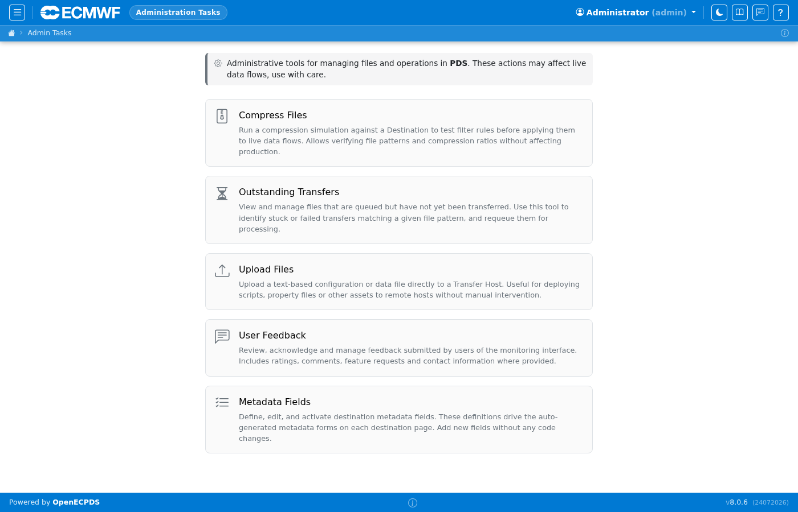

# Administration

The Administration section provides system-wide management tools
available to users with administrator privileges.


## Administration

The admin home page provides access to: [Destination Metadata](../administration/destination-metadata.md) field configuration (defining custom fields attachable to destinations, e.g. contacts, procedures, Opsview notes), transfer requeue (bulk re-scheduling of failed transfers), file upload (injecting files directly into the data store), the audit/feedback log, [Product Descriptions](../administration/product-descriptions.md) (per-product/type Tips and Descriptions), [TLS certificate management](../administration/certificates.md), monitoring status colors, [Critical Password](../administration/critical-password.md) setup, and the destructive [Purge All Data](../administration/purge.md) reset tool.




## Storage Lifecycle Policies

At `/do/admin/storagepolicies`, administrators define and test replica-retention policies,
inspect dry-run estimates and persistent savings counters, and set per-file operator
holds. Opt-in enforcement preserves original copies until normal expiry; advanced
settings include pressure watermarks and lazy replication. File and transfer details
show retention status and link to hold management.
See [Storage Lifecycle Policies](../administration/storage-lifecycle-policies.md).

## Network Weather

`/do/admin/networkweather` controls **bounded passive dissemination and acquisition collection**
for selected local and Continental Movers. Collection starts **disabled**. An
administrator can **Activate collection** or **Deactivate collection** at runtime
without restarting the Master, Monitor or Movers. The same page separately controls
automatic historical discovery and scheduled probes. All optional features default
off. Empty measurements mean unavailable coverage, not healthy paths.

The page is organised in tabs: **Overview** (state, activation, capabilities,
storage and counters), **Manual scope**, **Automatic selection**, **Probes**,
**Sources** and **Measurements**. The last selected tab is restored after saving.
The probe results, source registration and measurement tables can be searched, sorted
and paged in the same way as the Storage Lifecycle Policies table; states and outcomes are
shown as coloured badges and paths without observations are marked **no coverage**.
A **Configuration Guide** button opens a short user guide, and the
<i class="bi bi-info-circle"></i> icon on each card expands a short explanation of its content.

Paths, source/transfer-group scopes, pins, exclusions and probe policies are
edited with builders rather than free text: choose a source (or *Other source*
for a Continental Mover root), filter and select an active Dissemination Host,
then press **Add**. The Host target and method are filled in from the Host
configuration; duplicates, limits, invalid characters and probe mode/interval
combinations are refused immediately, and saved entries that no longer match an
active Dissemination Host are flagged. Pins, exclusions and probes can also be
picked from the approved candidates. Probe **Port**, **Mode** and **Interval** are
in a shared settings block used by both add methods. Selecting a Host or candidate
fills the port from that Host's transfer-module Properties (including the module's
default when unset). Selecting another Host or candidate refreshes it; manual
overrides remain possible. When no configured port is available, a usual port is
suggested and labelled for verification, or the port must be entered manually.
Saved policies keep their explicit port; Host changes do not rewrite them. The builders only assist
entry; every save is validated. Selector choices (Movers, transfer
groups and active dissemination/acquisition Hosts, up to the deployment's `maxHostChoices`) can
be updated with **Refresh choices**.
Without JavaScript, the underlying one-entry-per-line fields remain usable.
Path builders hide entries already added for the selected source, including in
the approved-candidate shortcut. Removing an entry makes it selectable again;
the same Host remains available for other sources. Probe builders still allow
the same path with different probe settings, but hide exact policies already added
from both Host and approved-candidate selectors. Changing the port, mode or interval
refreshes those choices; removing a policy makes it available again.
Source/group candidate discovery skips Hosts with invalid path configuration and
continues with valid Hosts. A warning reports the number of distinct rejected Hosts;
expand **Rejected Host IDs and reasons** to identify and correct them. The report
reflects the latest candidate check during Save or automatic reassessment and is
refreshed on the next check; it is not a permanent rejection list. Host configurations
and ordinary transfers are not modified. Database errors, discovery limits and
invalid individually approved paths still fail explicitly.
The source/group builder allows one transfer group per source: its group selector
and Add button are disabled for a source already listed, until that entry is removed.
The same transfer group can still be assigned to other sources.
Save errors identify policy sections and offending paths, and line numbers for
probe and source/group input. Pins, exclusions and probe paths must first appear
in Approved candidates; a changed Host target or method requires updating its approval.
If a save fails, submitted entries and switches remain in the form so they can
be corrected and submitted again. These displayed edits are not saved until the
Master accepts the request; reloading the page retrieves the saved configuration.
**Refresh choices** uses the Monitor's shared confirmation modal if it would discard edited entries,
unfinished builder input or switch changes. Cancel keeps the current form.

### Deployment capacity

Capacity is configured in the Master's properties file under `[NetworkWeather]`.
The page displays the effective limits and validates entries against them.
These capacity values do not need to
be duplicated in the Monitor or Mover configuration. Restart the Master after changing
them; lowering limits below an existing saved policy requires reducing that policy first.
Collection and probe activation remain separate runtime switches in the administration UI.

| Setting | Default | Scope |
|---|---:|---|
| `maxSources` | 20 | Distinct source Movers; source/group entries still allow one group per source. |
| `maxSelectedPaths` | 50 | Simultaneously monitored paths and maximum pinned paths. |
| `maxCandidates` | 500 | Explicit approved pool and combined group-discovered pool; also bounds exclusions. Must be at least `maxSelectedPaths`. |
| `maxProbePolicies` | 50 | Configured scheduled probe policies. |
| `maxHostChoices` | 5000 | Hosts available to the selectors; the filter shows at most 300 matches at once. |
| `maxConfigurationBytes` | 49152 | Maximum size in bytes of each saved configuration; up to 16,777,215 bytes. |

For example, a larger deployment can use:

```ini
[NetworkWeather]
maxSources=80
maxSelectedPaths=1000
maxCandidates=10000
maxProbePolicies=200
maxHostChoices=20000
maxConfigurationBytes=4194304
```

These are sizing examples, not throughput guarantees. Increasing the policy count
does not automatically increase probe execution frequency or collection capacity.
Larger configurations also require sufficient database storage capacity.

Large browser submissions also need adequate Monitor form capacity. Set, for example,
`maxFormContentSize=16777216` under `[MonitorPlugin]` in the Monitor's properties file
and restart it. The default is 200,000 bytes; budget for all submitted fields together
and URL encoding, not just one policy field. Check any reverse proxy's request limit too.

For many selected paths on an individual Continental Mover, its control response
may exceed the default 65,536-byte bound. Set `[NetworkWeather] maxControlResponseBytes`
to an appropriate positive byte count on Movers and relays receiving those replies,
and restart those services. This setting is local to those services, not supplied by the Master.

### Automatic selection and historical discovery

In the **Automatic selection** tab, approve explicit candidates
using `source | host ID | configured target | transfer method | type`, where type
is `DISSEMINATION` or `ACQUISITION`, or approve bounded
`source | transfer group` scopes. Group scopes discover active dissemination and acquisition Hosts
without maintaining an individual list. A source/group approval is administrative
scope, **not evidence that this source performed a historical transfer**.
The candidate, selected-path and emitting-source limits are deployment-configurable
(defaults: 500 candidates, 50 selected paths and 20 sources).
Pins, exclusions and probe policies reference explicit approved candidates; exclusions
override pins. Saving the automatic policy does not activate passive collection.

Enable **Automatic selection** to reassess daily, or request an earlier reassessment.
Enable **Allow bounded historical SQL discovery** separately to rank candidates using
seven days of upload activity, successful retrievals and destination-scoped trouble samples.
Retrieval samples use downloaded DataFiles linked to the acquisition Host (up to 50
recent files per Host, 100 Hosts per assessment, with a resumable Host cursor);
deleted DataFiles cannot contribute. Upload addresses are matched only to approved
dissemination targets, so a retrieval is not inferred from an upload to the same address.
Historical rows never
establish actual emitting-source identity. Ranking mixes activity, trouble and
source/method diversity. Existing valid coverage is retained on partial input or
failure; complete runs can replace at most 10% of the configured selected-path capacity
(rounded down, minimum one; five with the default capacity) of unpinned, non-troubled paths per day,
and only with materially stronger evidence. Known invalid or excluded paths are
removed before optional history work, even if that later work fails.
An empty automatic selection suspends collection without erasing activation intent.
If recording a pruned scope fails, removed paths remain stopped in that Master;
the page warns to retry before restarting, since the last saved scope still exists.

Use **Find candidates from successful transfers** in Automatic selection to search
a user-chosen period of 1–30 days, optionally filtered by protocol (ECtrans module,
such as FTP or SFTP). The protocol filter uses the Host's current transfer method
and is applied in the database search.
Choose the source to assign explicitly: transfer history identifies the successful
Host but not its historical source. Only currently
active dissemination Hosts with a `DONE` history entry, and acquisition Hosts with a
successfully downloaded DataFile in that period, are suggested. Retrieval timestamps
come from the DataFile's recorded completion time, not from a later dissemination.
Already-approved paths for the chosen source are omitted from the preview.
Review and select matches, then add individual Approved candidates or source/group
scopes. Group scopes also permit Hosts without a recent success and support only
one group per source. Existing entries are preserved and duplicates are skipped;
conflicting groups and capacity errors leave the form unchanged. The preview is
searchable and paginated (50 Hosts per page), with selections retained across pages.
Search results use `maxHostChoices`; adding paths uses `maxCandidates`.
Click **Save** to persist the additions. Search failures and result-limit errors
are displayed rather than silently returning incomplete results.

**Historical discovery** is separate: it ranks already permitted candidates using
up to seven days of activity, volume and error signals. It neither populates approval
lists nor limits selection to Hosts with successful transfers.

Policy, selection and discovery progress survive restart. Assessment
counters and reasons are transient. Query errors and partial samples
are visible in the administration status. Disable automatic selection before saving
a fixed manual scope. Automatic policy changes are rejected during an in-flight
reassessment; retry after it finishes.
Historical discovery samples activity rather than providing an exhaustive history
scan. Assess its database load on a test system before enabling it in production.

### Scheduled diagnostics

Approve probes separately with:
`source | host ID | configured hostname | method | type | approved service port | mode | interval seconds`.
Both dissemination and acquisition paths support probes; the type is retained in
the policy, result tables and Live Earth overlay.
Review the explicit port against the real transfer-module service configuration;
the scheduler never guesses a port, performs protocol login or sends credentials.
`TCP_CONNECT` requires an interval of at least 60 seconds; `MTR_ICMP` and `MTR_TCP`
require at least 300 seconds. New automatically selected paths do **not** acquire
probe approval. MTR needs a JSON-capable `mtr` executable and suitable privileges
on the actual emitting Mover.

Jobs run in the background on the selected local or Continental source, not on
a substitute source. A missing tool,
insufficient privileges, malformed output, no target response and missing source
results are distinct from measured connectivity success. Intermediate-hop loss
does not establish an end-to-end fault.

Completed diagnostics and source-unavailable notices are kept for one hour and
do not survive a Master restart. They are not a permanent probe archive.
Collection deactivation or probe-policy removal stops further scheduled work.
Existing transfers and interactive diagnostics are unchanged.

### Live Earth weather overlay

The Network Weather icon (<i class="bi bi-cloud-lightning-rain"></i>) in the Live Earth
toolbar is shown while collection is active or its state cannot yet be confirmed.
Click it to switch the overlay on
(highlighted) or off (normal); it starts **off**. Its preference is saved
in the browser, independently of transfer animation and other globe
preferences. Enabling it displays a searchable table of permitted source/Host/method
evidence, socket coverage, observation age and available diagnostic summaries, plus
independent Host-location halos. Gray/absent evidence means unknown coverage, not
healthy connectivity; orange delivery trouble is not a network-fault diagnosis.
Unresolved coordinates (including internal addresses) do not create invented locations,
but never hide the icon or permitted table rows. The Dissemination and Acquisition
filters apply to their respective overlay paths.

Visibility follows the viewer's monitoring, Host and destination permissions.
Paths lacking permitted retained
delivery evidence are not disclosed to restricted viewers. Raw endpoint addresses,
MTR hops, transfer IDs and administrative errors are not sent to the globe.
Idle paths with previously permitted retained evidence show no recent observations,
not zero-latency success. Viewing the overlay never starts collection or a probe.

When collection is disabled or suspended, the server returns no weather paths and
the icon is hidden and the overlay cleared on the next refresh. Errors and stalled
requests also clear stale evidence, but keep the icon available: its tooltip and opened
panel show the failure rather than silently disappearing. A disabled collection overrides a saved `on`
preference. The preference is retained, so it can resume when collection becomes
available again.

### Scope and runtime controls

The **Manual scope** builder stores paths as
`source | host ID | configured target | transfer method | type`.
Use the actual emitting Mover root, not its relay. The target and transfer method
and type must exactly match an active dissemination or acquisition Host; these settings are checked again
on activation. The limits come from the Master's deployment configuration. A blank scope clears the
selection. **Saving scope disables collection**, requiring explicit reactivation.

Activation requires database readiness and verified registration for every
selected source. The page displays blockers,
registration state, five-minute observed counts and persistence health. Source
loss after activation gates that source independently; it does not stop unrelated
sources. Controls require administration permission and are audited.

Deactivation stops collection; source capture can take up to 60 seconds to stop.
Measurements already being saved can finish; retained measurements are not erased.
If recording deactivation fails, the Master stays stopped and reports the error:
retry before restarting, because the previously saved activation intent can
otherwise be restored. Ordinary transfer processing, KPI byte accounting and
viewer-driven animation are not stopped.

The scope and activation intent survive Master restarts. Restored activation
starts suspended until readiness checks succeed. Database problems can suspend
collection; recovery can resume saved activation intent. Pending measurements
and the current assessment do not survive a restart.

### Source registration and transport

Updated Movers negotiate by default (`[Server] networkWeatherNegotiation=yes`).
An explicit `no` remains a per-Mover opt-out. Negotiation alone captures nothing.
Continental routes require `[Security] rccSharedSecret` signing at every hop.
Deploy matching Master, Monitor, local relay and Continental Mover versions.
Sources must be registered and verified before collection can start; the
**Sources** tab shows their current registration state.

For a selected Continental source without a direct subscription, an operator
can explicitly approve its existing Proxy Host on the Master:

```ini
[NetworkWeatherRelay]
continental-source.example=101
```

The key is the actual Continental Mover root; the value is the existing active
Proxy Host ID, not an arbitrary URL or relay hostname. A subscribed local Mover
from that Host's configured transfer group must be available to reach the
Continental source. A failed source mapping does not stop verification of other
sources.

The local relay must use `[MoverProxy] trustAllCerts=no`, valid HTTPS target
names and an appropriate JVM truststore. Registration rejects HTTP, URL user
credentials and trust-all certificate mode; shared request signing alone does
not authenticate the source. All target alternatives must satisfy these checks.
Keep service clocks synchronised: excessive clock differences can prevent
measurements from being assigned reliable observation times.

### Measurements and coverage

Collection records dissemination and acquisition GET outcomes and available socket measurements
independently of Live Earth viewers.
Acquisition evidence is attributed to the requesting transfer and destination, including
individual GETs in indexed retrievals; listing and size queries are not counted as payload
retrievals. Shared-file aliases do not fabricate additional destination evidence.
Successful and failed transfer attempts and explicit
cancellations can contribute evidence. Some early failures have no measurements.
Other Host types (such as backup, replication and proxy) are not included.

Existing module socket-statistics settings still determine available measurements;
acquisition payload GETs request diagnostics just as dissemination does, without
overriding `ectrans.socketStatistics="false"`. Late socket closures can supplement
their recorded execution. The transfer detail page separates retrieval and
dissemination socket measurements using the stored leg; unidentified legacy rows
are not assigned to a leg by inference.
Missing or dropped measurements mean coverage loss, not packet loss.
Failures without socket measurements remain sending outcomes, not zero-valued
connections. RTT, sent/received bytes, rates and other socket measurements are
shown when available; missing values remain unavailable.

The **Overview** and **Measurements** tabs show collection and persistence health.
Accepted observations may still be awaiting storage; acceptance alone does not
mean they have been saved. Database failures, capacity limits and expired
observations can leave coverage gaps. Transfer details show sending outcomes when
available and identify missing provenance; the sending index is not a requeue count.

### Deployment validation

1. Keep collection disabled and deploy matching components. Confirm database
   readiness on the administration page.
   **Do not load the destructive full installation dump into a populated database.**
   Schema operations require the site's database change procedure, backups and DBA
   review.
2. Configure approved Continental routes and verified HTTPS/signing, then save a
   small local and Continental scope. Wait for writer readiness and source
   registration. Activate from the administrator page; no service restart is
   needed for subsequent controls.
3. Exercise successful and failed deliveries, plain retries/requeues, cancellation,
   late socket cleanup, relay outages and service restarts. Check source capture,
   saved measurements and reported coverage gaps. Test with
   nobody viewing Live Earth, and compare transfer latency, database/pool load
   and ordinary byte totals against the disabled baseline.
4. Deactivate and verify that collection stops while
   transfers continue. Only enable in production after the test-system outcome
   and the normal deployment review are satisfactory.

## Monitoring Status Colors

Administrators can configure the shared status palette at
`/do/admin/monitoringcolors`. The settings cover product-generation,
OpenView, and arrival/transfer statuses used by monitoring legends, indicators,
and charts. Values are stored in the shared system configuration and must use
`#RRGGBB` format. Saving a value equal to its built-in
default removes the override; **Reset All to Defaults** removes every override.
Changes apply immediately on the current Monitor and are picked up by other
Monitor instances within 15 seconds.

## Scheduler Traffic

**Scheduler Traffic** (`/do/admin/schedulertraffic`), linked from Administration
Tasks, the start page and the administration menu, monitors the Master's current
**Proxy**, **Backup** and **Replication** workers. Switch between the three types
using the buttons above the table. The read-only page uses the same card/table
style as Outstanding Transfers, with local filtering, sorting, pagination,
manual refresh and a selectable auto-refresh interval (5 seconds by default).

Each row represents one current worker per data file, identified by the transfer
that started it; aliases can share a file. It shows destination, transfer/data-file
links where permitted, requested Target, worker phase, transfer status, source
Mover when known, target Host, file size, start time and elapsed time.
**Starting**, **Processing** and **Finalizing** describe the scheduler worker;
the separate **Transfer status** describes dissemination, not whether this
background copy has succeeded.

Completed workers disappear. This is neither a waiting queue nor an outcome
history; consult the transfer history for completed or failed operations. Disabled
schedulers are explicitly identified, and connection errors are shown rather
than reported as an empty successful snapshot. Replication can involve several
members of a Mover group; Proxy/Backup select the source internally and Proxy
Host selection may change during an attempt. File size is not bytes moved:
these blocking operations do not expose reliable live percentage or throughput.

Refreshing the page does not start transfers or change scheduler behaviour.
Access follows the normal administration
URL permissions (`/do/admin/schedulertraffic`); deploy the updated Master and
Monitor together.
