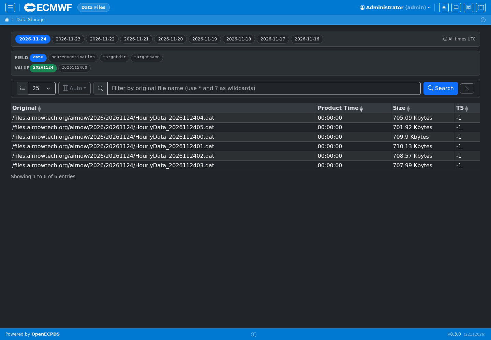
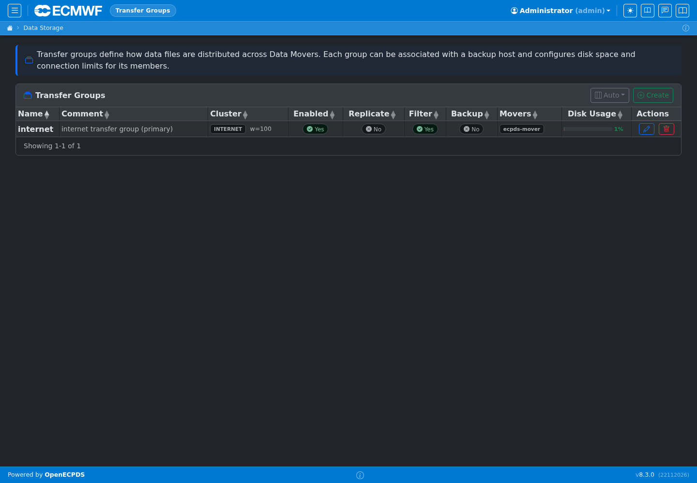
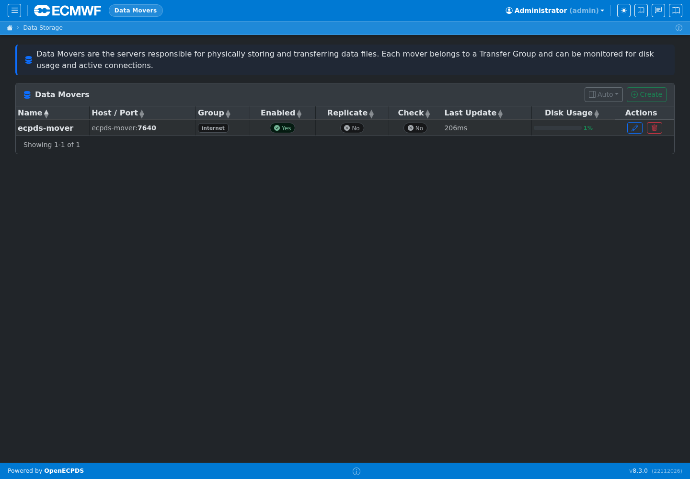
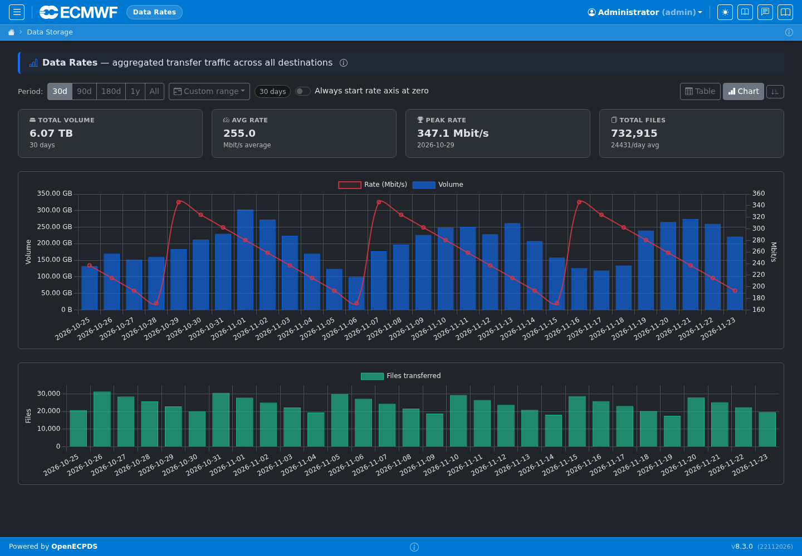
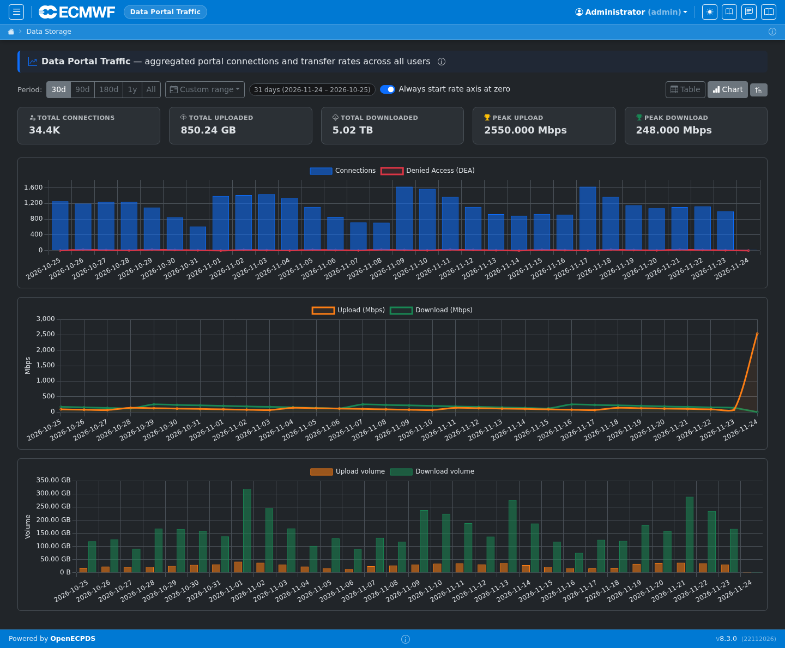
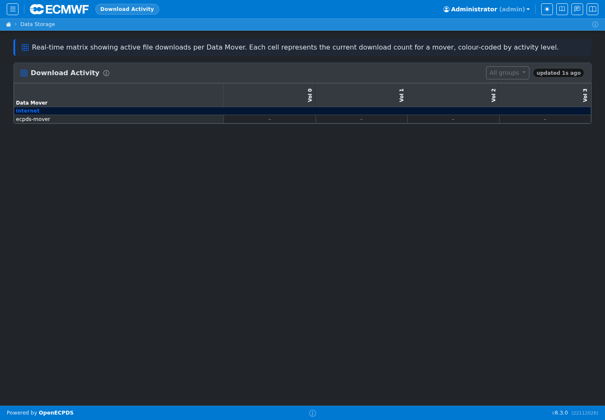

# Data Files & Infrastructure

The Data Files section provides visibility into the data objects stored by
OpenECPDS and the infrastructure components (Data Movers, Transfer Groups) that
handle them.

## Data Files

Lists data files known to the system. Each file can have multiple associated
transfer requests across destinations. Select a date and use the original-name
filter to narrow the list; column options provide additional details.

The list shows original names and sizes, while the
[destination page](destinations.md#destination-detail) shows the corresponding
transfer status. A stored file and its transfer requests are separate objects.

## Transfer Groups

Transfer groups pool Data Movers. When a transfer is scheduled, the master selects an available mover from the group. This page shows all groups, their member movers, and current load.

## Data Movers

Lists all registered Data Mover servers with their host address, disk usage, active connections, and operational status. A mover shown as inactive will not receive new transfer assignments until it re-registers.

Disk usage and device/mount details are served from background snapshots; opening
or refreshing these pages does not contact the Movers. Polls are single-flight per
Mover with at most 16 concurrent workers and no queued backlog. Device/mount
details are refreshed every five minutes. Shared-filesystem volume sizes use
recursive scans, reused for 30 seconds; dedicated filesystem usage still uses
filesystem counters. These samples are approximate during concurrent transfers.
Usage older than two minutes is marked **Stale** in the Monitor. Refresh requests
time out after 12 seconds, do not overlap, and retry transient failures without
discarding the last displayed snapshot. Disabled Movers and inactive transfer
groups are not polled.

## Data Rates

The global Data Rates page combines daily transfer figures across destinations.
The summary cards show volume, average rate and file counts for the selected
period. Volume bars and the rate line make it easier to distinguish a busy day
from a slow delivery period; rate is computed from bytes and cumulative transfer
duration, not from the length of the day.

Choose **30d**, **90d** or **Custom range** to focus on a period.
Switch to **Table** to read the daily figures; the period controls update the
cards, chart and table together. Individual destinations also have a Traffic view.

## Portal Traffic

Displays upload and download activity through the Data Portal, aggregated across
Data Users. Open a Data User's Portal Traffic page for that user's figures.

The Connections chart shows daily authenticated connections alongside denied access attempts (DEA) from portal authentication and access checks. Other charts show upload/download rates in Mbps and upload/download volumes for the selected period. The same charts are available for an individual Data User's Portal Traffic page.

Read the charts together: **Connections** shows demand and denied attempts,
**Transfer Rates** compares upload and download throughput, and **Volume** shows
the bytes moved in each direction. More connections do not necessarily mean
more transferred data. Use the same period and custom-range controls as Data Rates.

## Mover Downloads

Shows live download sessions active on each Data Mover. Each row shows the remote client IP, the file being transferred, bytes sent so far, and elapsed time.

