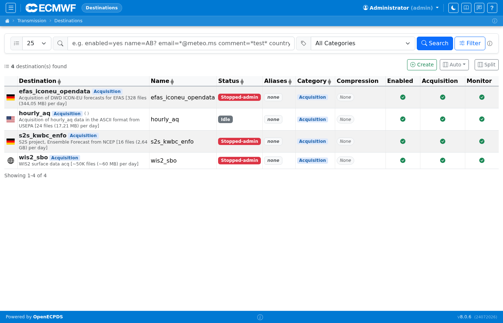
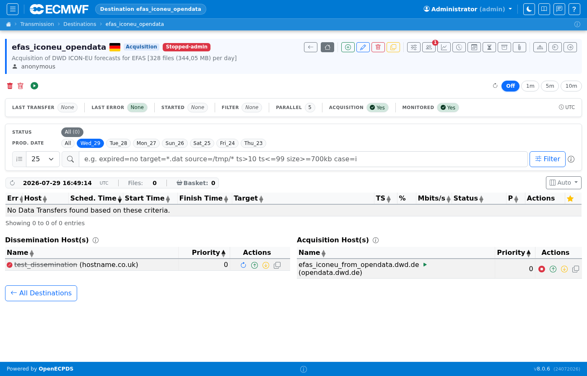

# Destinations

A **Destination** is the core scheduling unit in OpenECPDS. It represents a
named data feed — either a dissemination target (data is pushed to it) or an acquisition
source (data is pulled from it). Each destination has a queue of transfer requests,
one or more associated hosts, and a set of options that control scheduling behaviour.

## Destination List

The destination list shows all configured destinations with their type (Acquisition, Dissemination, Time Critical, or any custom type defined in the server configuration), status (active/stopped/held), queue depth, and last transfer time. Click a destination name to open its detail page.

!!! note "Standalone container"
    All four sample destinations (`efas_iconeu_opendata`, `hourly_aq`, `s2s_kwbc_enfo`, `wis2_sbo`) are of type **Acquisition** — they pull data from external sources.

## Destination Detail

The destination detail page shows the current queue for that destination: pending, running, done, and failed transfers. The toolbar provides actions to hold, release, flush, or reconfigure the destination. The Properties tab shows the destination's scheduler and incoming options.

### Host activity and discovery

The **Dissemination Host(s)** and **Acquisition Host(s)** sections have an **i**
button that expands an explanation of their scheduling, indicators and limits.
The information/warning icon beside each Host name explains that Host's limit
scope and the upper bound for this Destination.

| Indicator | Meaning |
|---|---|
| Steady green dot | The Host is enabled, not necessarily reachable or healthy. |
| Disabled symbol and struck-through name | The Host is administratively disabled. |
| Pulsing green dot | Counted outgoing transfer activity for dissemination, or counted Master-scheduled retrieval activity for acquisition. |
| `N active` | This Destination's active outgoing transfers on that dissemination Host. |
| `selected` with retry usage | The dissemination Host selected for new dispatches, with its current Host retry usage. |
| `N retrieving` | This Destination's active Master-scheduled retrieval jobs through that acquisition Host. |
| Discovery running/stop indicator | A directory-listing and file-discovery cycle is running; this is separate from file retrievals. |

Counts represent scheduled jobs, not physical sockets. Zero-count activity pills
are hidden. For a shared acquisition Host limit, the retrieval pill's tooltip also
shows combined Host slot usage across Destinations on the same Master.

**Dissemination** uses Host priority and failover settings. Lower priority numbers
take precedence, but the scheduler can remain on a working fallback Host rather
than returning to the primary for every transfer. The selected Host receives new
dispatches; transfers already running on another Host can still finish there.

**Acquisition discovery** lists remote directories and evaluates entries against
the Host's rules. Eligible Hosts are processed independently and can run in
parallel, subject to acquisition timing and scheduler capacity; the Priority
column does not create an acquisition failover chain.
Users with the required permission can use the play button to request discovery
now, or the stop button to interrupt the current discovery cycle. Stopping
discovery does **not** cancel retrievals already scheduled or running.
Network Weather probes are separate from both discovery and file retrieval.

**File retrieval** is scheduled separately for files selected for queueing.
Host and Destination connection limits apply to Master-scheduled acquisition,
along with the download scheduler's pool limit. The Destination maximum caps
retrievals and outgoing dissemination as **two independent pools**: a setting of
5 allows up to 5 retrievals and 5 outgoing transfers, not 5 combined.
Directory listings, probes and idle connections are excluded.
Mover-side on-the-fly recovery of a missing file bypasses the acquisition limits
and retrieval pill, while an outgoing transfer served by that recovery still
occupies its dissemination slots.
See [File-transfer connection limits](../host-directory/index.md#file-transfer-connection-limits).

On acquisition Destinations, Host status is refreshed approximately every four
seconds while the page is visible. On dissemination-only Destinations it is
loaded when the page opens. If a status request fails, stale activity badges are
replaced with an unavailable warning and activity pulsing stops; this means
status is unknown, not that the Host is idle or down.

### Editing a Destination

The edit form groups settings into **Identity**, **Delivery**, **Limits**,
**Directory**, **Notifications**, **Flags** and **Options**, alongside Host,
user, policy, alias and metadata associations. Each card's **i** button expands
contextual help in the shared neutral panel with a blue top border.
Field-level **?** tips explain individual settings.

The **Max Connections** tip and Limits information panel explain the independent
retrieval and dissemination pools. **Enabled** controls scheduler participation;
**Show In Monitor** controls visibility rather than enabling or disabling work.
Acquisition requires both the **Acquisition** flag and an associated Acquisition
Host. The Directory card controls the date-directory view for incoming FTP/SFTP
users, not remote acquisition listing paths or dissemination target paths.

Use the **Limits & Failover Guide** in Delivery or Limits for concurrency,
Host retry budgets, Destination holds, individual transfer delays/failures and
queue troubleshooting. See also [Destination retry controls](../architecture/failover.md#destination-retry-controls).
The **Alias Routing Guide** in Destination Aliases explains outgoing link
direction, fan-out, chains and conditional routing. Use the detail page's
**Aliased From**, **Aliases To** and alias diagram to check routing relationships
before changing them; see [Aliases](../concepts/entities.md#aliases).
Options provides a separate **Properties Reference** for supported option keys
and defaults. Guide buttons retain their full accessible names when displayed
as book-only controls on small screens.

### Change Log

The **Change Log** records Destination settings and Host changes made through
authenticated Master session actions, with the user and time of each successful
change. Host entries distinguish allocation, removal, priority changes, global
enable/disable and global deletion. Copying a Host into a Destination or copying a
Destination also records the resulting Host allocations. Backup imports through
the API record allocations with an `API/<client ID>` actor, never the API secret.

An enable/disable or deletion of a shared Host appears in every Destination
associated with it at the time of the action, not only the Destination from which
the action was requested. Entries retain the Host ID, nickname, address and
Destination-specific priority, so removing or deleting the Host does not erase
that identity. These snapshots do not include Host credentials.

Host events show **vs Previous** only: comparing an association or a global Host
state with the current Destination settings would be misleading. Ordinary
Destination settings retain both comparison tabs. Unchanged priorities/states and
failed actions do not create Host-change entries. History starts when this
version is deployed; previously unrecorded changes cannot be reconstructed.
The existing anonymous-user and `dontRecordActions` exclusions still apply.
As with existing settings history, database recording failures are logged but do
not roll back a completed configuration change.

### Transfer tries

Choose **Cols → Custom → Tries** to show the number of attempts to reach each
transfer's current status, using the same count as the destination timeline:
requeues plus one. A value of **1** means no requeue. The column supports numeric
sorting and is hidden by default; it is available only in Custom mode.

### Delivered filename

**Target** remains the requested filename. Host settings can change the filename
or path actually used by a delivery module. The transfer detail page shows
**Delivered name** when the module reports a different name after successful
delivery. It is shown only for transfers whose current status is **DONE**.
The display falls back to **Target** when no different name is recorded.
Comparison is exact and case-sensitive; names are not inferred from comments.

In the destination queue, choose **Cols → Custom** and enable **Delivered**
to display it immediately after **Target**. The column is not included in Auto, All, Compact or Small modes.
Existing saved column selections are preserved.

Use `delivered=*/in/*` to search this field, or combine it with other conditions,
for example `target=*.dat delivered=archive/* case=i`. Wildcards, quoting and
`case=` work as for `target=`. The same filter applies to transfer rows, counts
and filtered basket selection. Only **DONE** transfers match `delivered=`.
When their stored delivered name is NULL, `delivered=` searches **Target** instead.
Sorting uses the same effective filename. This does not change stored values.
Failed, queued, running and other non-DONE transfers show an empty Delivered
value and do not match a delivered filename filter, even if an older name remains
stored. Historical DONE transfers and modules that do not report a name use the
Target fallback; this does not recover an unrecorded historical remote filename.

The field describes the latest delivery attempt, not a history of remote names.
It is cleared when a new Mover delivery attempt starts and populated on success.
Historical transfers are not backfilled.

Recording the name uses the existing transfer update path: there is no additional
database request per transfer or parsing of history messages. No index is added
for the new text field. Searching or sorting it can cost more on large result
sets; destination and time/status filters still constrain the existing queries.
