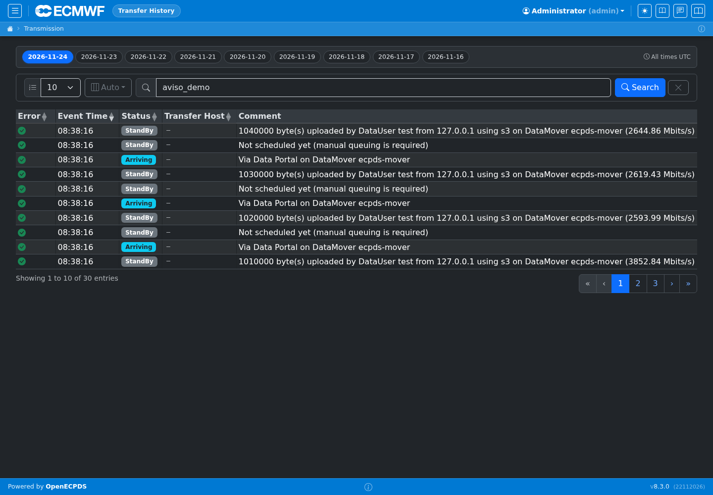

# Transfer History

The Transfer History section provides a searchable, filterable log of all
transfer requests that have been processed by OpenECPDS. It covers both successful
and failed transfers across all destinations.

## Transfer History

The history page lists transfer events, including status changes and their
comments. Select a date and use the search box to narrow the results. The
example shows recent arrival and standby events for local `aviso_demo` uploads,
including the recorded byte counts, protocol and serving Data Mover. These are
not completed deliveries. The page-size selector limits the example to the ten
most recent events.

The cross-destination transfer list also offers **Delivered** immediately after **Target** through
**Cols → Custom**, and accepts `delivered=` in the search box and query builder.
The transfer detail page shows it separately from the original **Target**, and
updates it when a delivery completes. It is recorded only for a module-reported
name that differs from Target; when no different name is recorded, the display and filter fall back to Target.
Delivered is shown and searchable only for **DONE** transfers. Other statuses
leave it empty, including failed and running transfers.
See [Delivered filename](destinations.md#delivered-filename) for examples and
attempt semantics.
