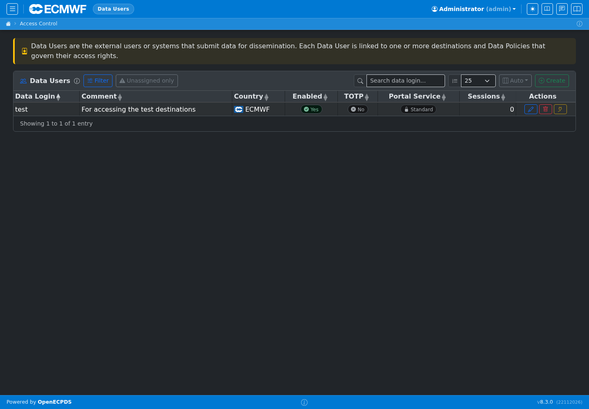
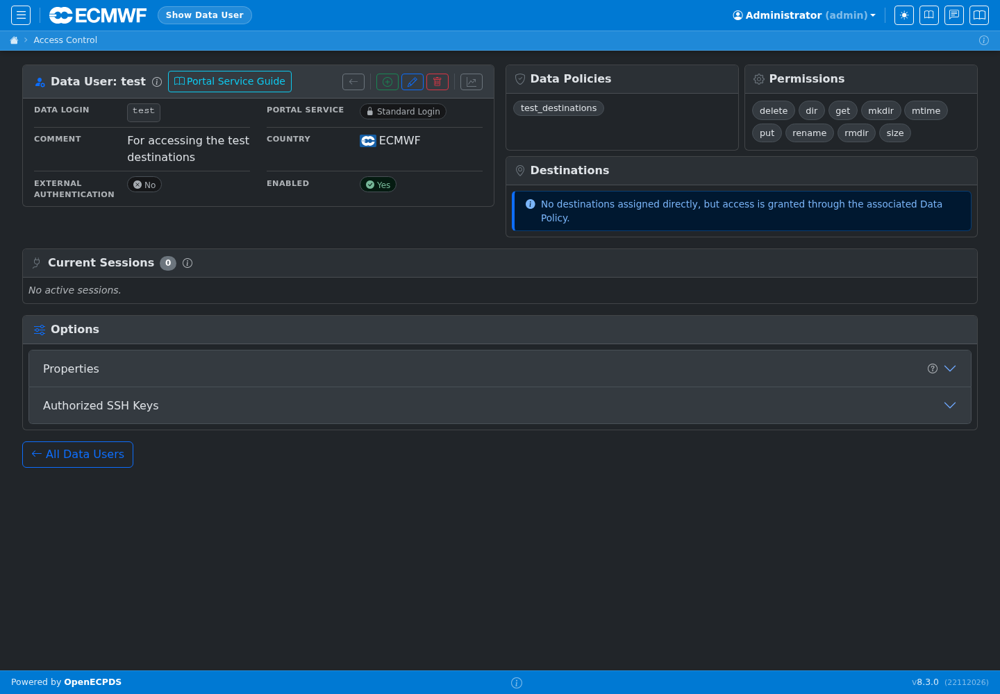
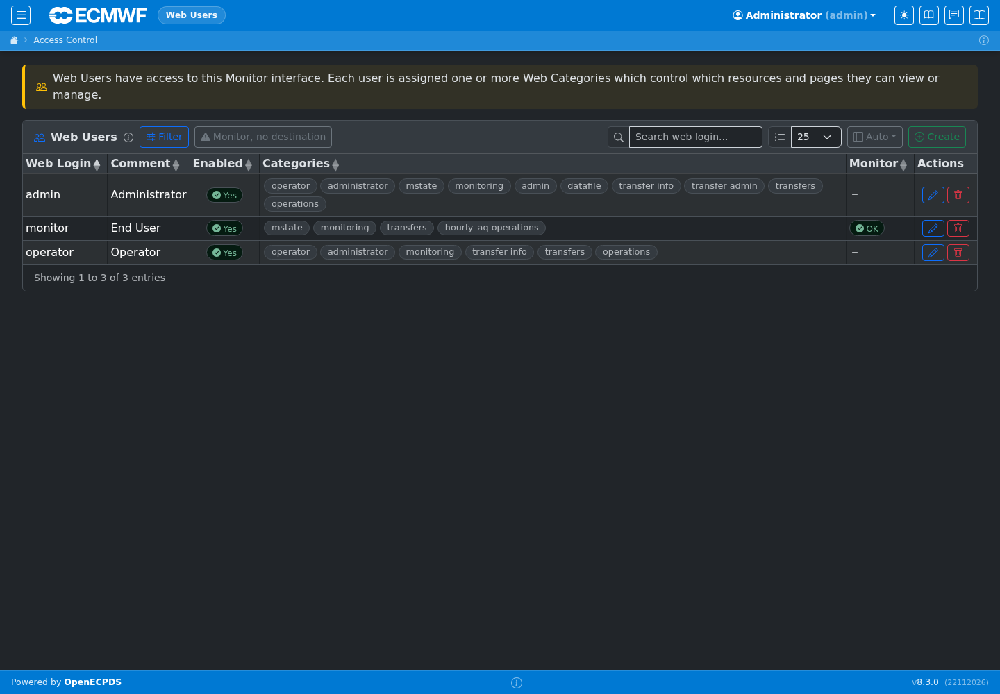
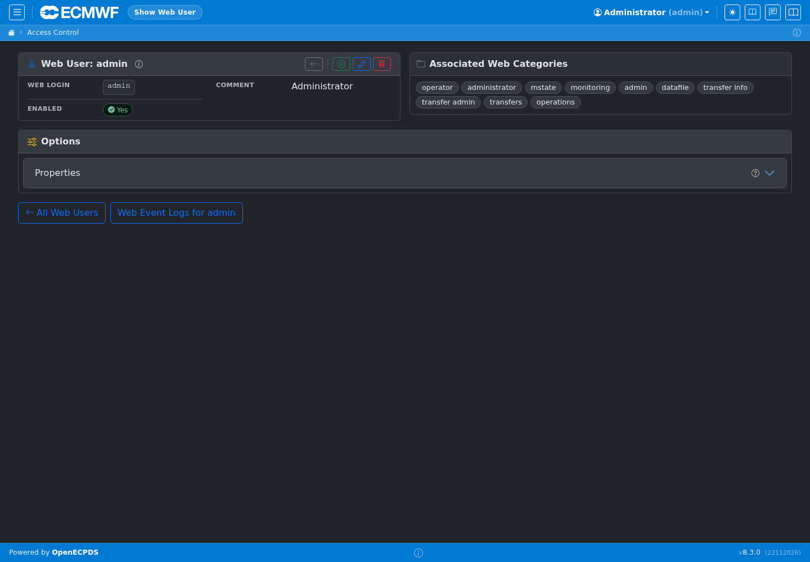
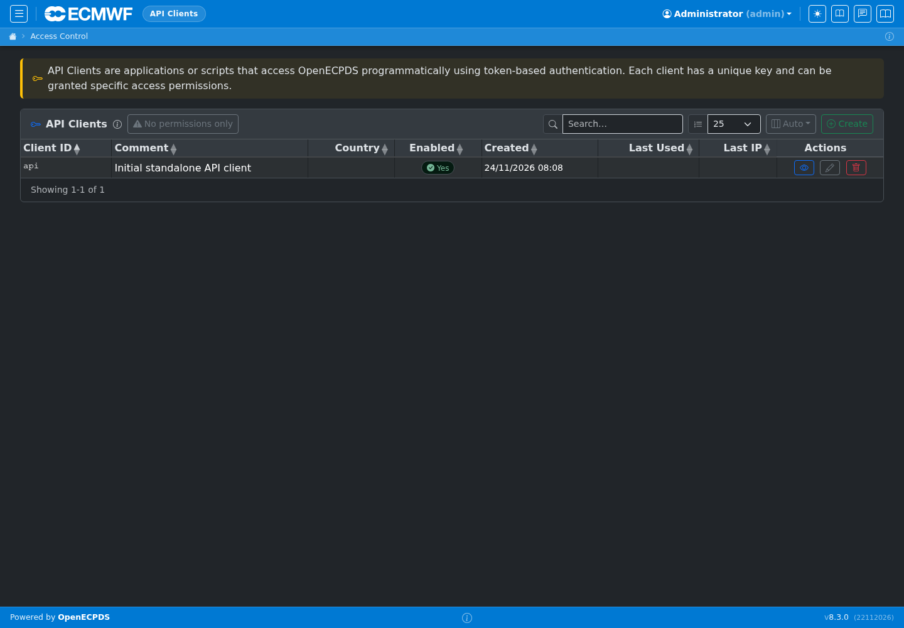
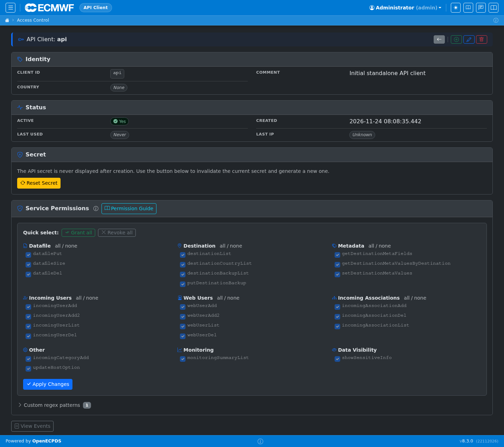
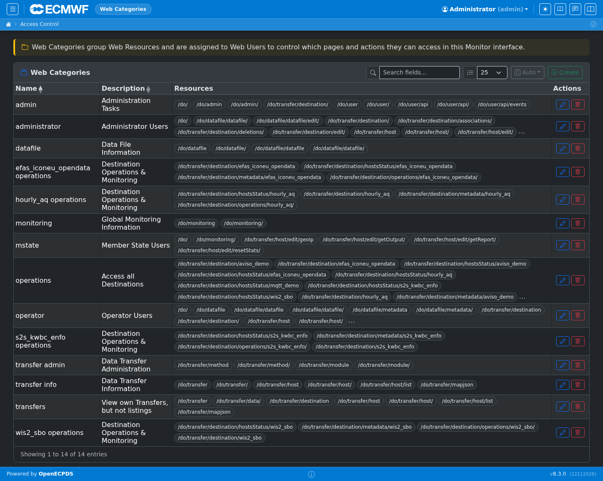
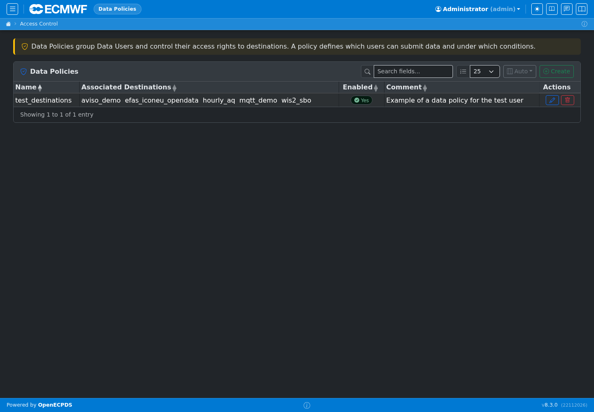
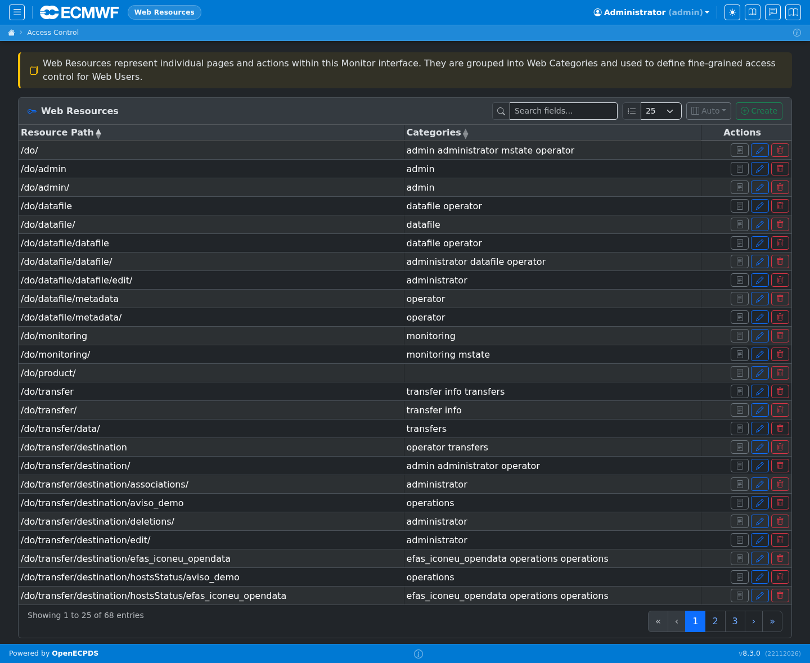

# Users & Access Control

Access Control separates three kinds of identity:

- **Data Users** (`IncomingUser`) — external users who access data through the Data Portal
- **Web Users** — operators and administrators who access the monitoring interface
- **API Clients** — applications using the Master REST API with service permissions

Access is further controlled by **Categories**, **Policies**, and **Resources**.

## Data Users

Lists all Data Portal users. Each user has a login, associated destinations (their accessible data), a portal service mode (Standard Login, Open Access, or Self-Service Registration), and optional quotas and geo-blocking rules. Click a user to edit their properties and destination associations.

The **Filter → Live session protocol** selector shows only users with at least one
current FTP, SFTP, HTTPS/Data Portal, MQTT/MQTTS, WebDAV or S3 session matching
the selection. It combines with the other filters and is preserved in the page
URL. It checks current connections, not connection history, subscriptions or
protocol permissions. **Any** imposes no session requirement. Session counts
still include all protocols; reload the list to refresh the session snapshot.

## Data User Detail

The detail page shows the user's current portal settings, associated destinations, connection history, and subscriber list (for MQTT notification subscriptions). The Properties editor accepts `portal.*` options to configure quotas, CORS, branding, and path permissions.

### Current Sessions

The Data User detail page includes a **Current Sessions** table showing all live portal connections for that user, updated each time the page is loaded.

| Column | Description |
|--------|-------------|
| **Session ID** | Internal session identifier |
| **Protocol** | Connection protocol: `https`, `sftp`, `ftp`, `mqtt`, `webdav`, etc. |
| **Remote IP** | Client IP address |
| **Data Mover** | Which Data Mover is serving the session |
| **Start Time** | When the session was opened (UTC) |
| **Duration** | Time elapsed since the session started |
| **Downloads** | Active and total download stream counts in `active/total` format (e.g. `1/5`). The active count is shown in blue when non-zero. Only tracked for HTTPS sessions. |
| **Uploads** | Active and total upload stream counts (same format). Only tracked for HTTPS sessions. |
| **Bytes In** | Accumulated bytes received from the client (uploads) |
| **Bytes Out** | Accumulated bytes sent to the client (downloads) |
| **Action** | Disconnect button (for users with edit permission) |

#### Show Stuck filter

The **Show Stuck** button filters the table to show only sessions that are suspected to be stuck: HTTPS/HTTP sessions open for more than 30 seconds that have **never started any transfer stream**. Sessions with non-zero stream counts or non-HTTP protocols are never flagged.

!!! note
    Bytes and stream counts are tracked for **HTTPS/HTTP**, **SFTP**, **FTP**, **WebDAV**, and **S3** (incoming API) sessions. MQTT and other protocol sessions show zero.

## Web Users

Lists all monitoring interface users. Each user belongs to one or more categories that determine which destinations they can see and which management actions they can perform.

For a full reference including authentication options and access-control details, see [Web Users](../use-cases/web-users.md).

Open a Web User to inspect its assigned Web Categories. Categories control which
destinations and operations are available; a Web User is not a Data Portal account.

## API Clients

The API Clients list shows application identities separately from human Web Users
and Data Users. Open a client to inspect its active state, usage and service permissions.

The detail page groups identity, status and **Service Permissions**. The permission
picker and guide explain which Master REST services each pattern grants.
The initial standalone client shown below has broad access; applications should
receive only the permissions they need.

A client secret is shown only when created or reset. It is not recoverable from
the detail page, and resetting it invalidates the previous credential.
See [REST API authentication](../rest-api.md) for client usage.

## Categories

Categories are the primary access-control mechanism for Web Users. A category grants access to a set of destinations and a set of resources (URL paths). Users assigned to a category inherit all its permissions.

## Policies

Policies group destinations for assignment to Data Portal users. Instead of assigning destinations one by one, an operator creates a policy and assigns it to a Data User.

## Resources

Resources map URL path patterns to access-control entries. They are assigned to categories to grant Web Users access to specific monitoring pages or management actions.

---

## TOTP Authentication

OpenECPDS can delegate Web User and Data User credential validation to a configured
Master authentication provider. The bundled ECMWF provider supports passwords and
Time-based One-time Password (TOTP) passcodes.

- **Web Users** — a configured provider validates credentials for all users;
  local passwords are not a login fallback.
- **Data Users** — enable **External authentication** per user to use the provider.
  Without a configured provider, that user's login fails.

The ECMWF provider detects a **one-time passcode** (exactly 6 or 8 digits) or
a **password** and routes it to the appropriate endpoint client. Other providers
may use different rules.

For full configuration details and a behaviour reference table, see the [TOTP Authentication](../administration/totp.md) administration page.
